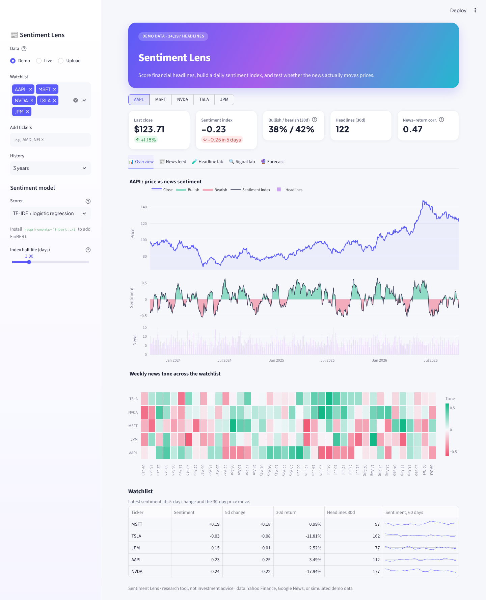
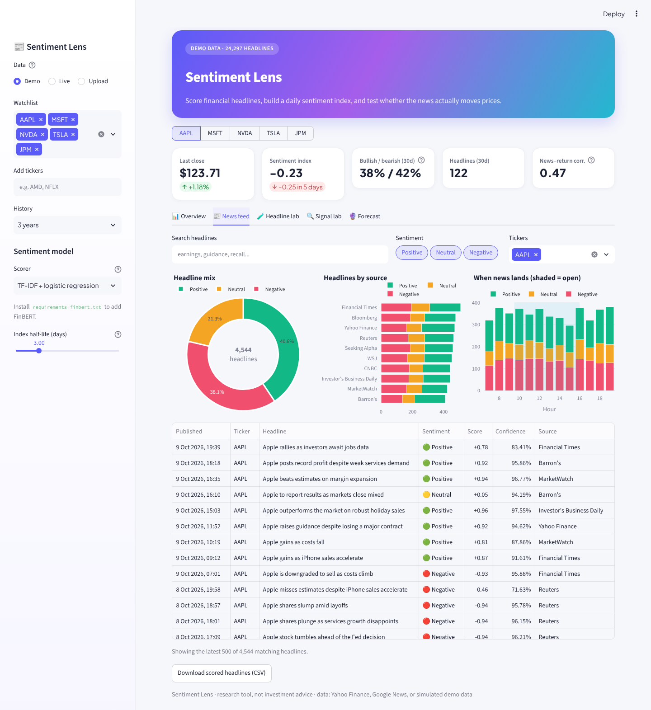
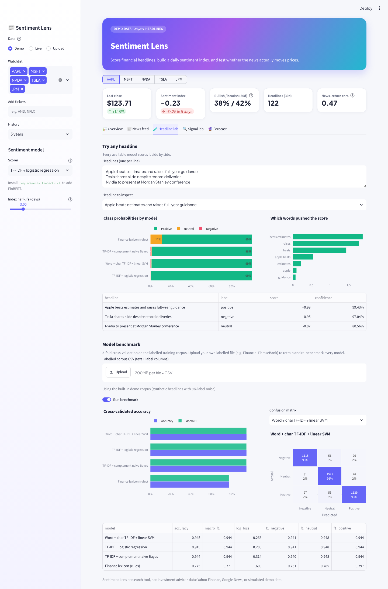
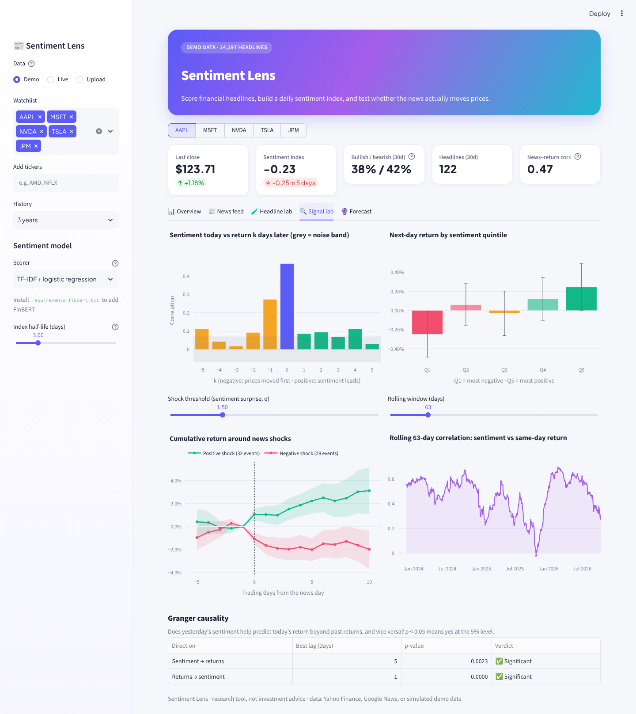
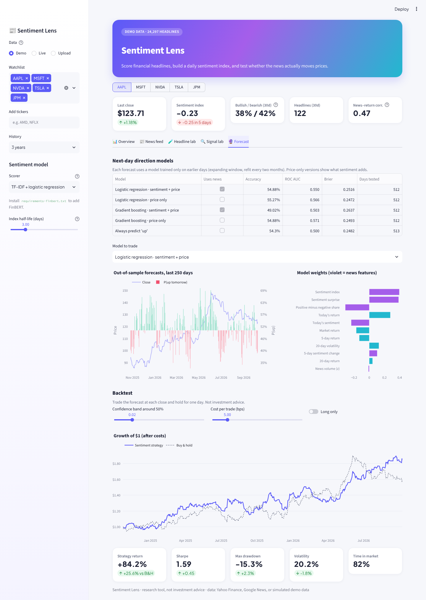

# 📰 Sentiment Lens: Financial News Sentiment Analyzer

[](https://github.com/gouravmurmu/Financial_Sentiment_Analyzer/actions/workflows/ci.yml)


Score financial headlines with four interchangeable models (plus FinBERT), turn them into a daily
sentiment index for each stock, and test honestly whether the news leads prices: lead-lag correlations,
Granger causality, event studies, and walk-forward forecasts compared against price-only baselines.



## What's inside

| Tab | What you can do |
| --- | --- |
| **📊 Overview** | Price, sentiment index (green bullish, red bearish) and news volume on one chart; a weekly tone heatmap and a sortable watchlist with 60-day sentiment sparklines. |
| **📰 News feed** | Search and filter every scored headline by ticker and sentiment; mix by label, by source and by hour of day; export to CSV. |
| **🧪 Headline lab** | Paste any headline and see every model's probabilities side by side, plus which words drove the score. Cross-validated benchmark with confusion matrices; upload your own labelled data (e.g. Financial PhraseBank) to retrain. |
| **🔍 Signal lab** | Lead-lag correlation (does news come before or after the move?), next-day return by sentiment quintile, event study around news shocks, rolling correlation, and Granger tests in both directions. |
| **🔮 Forecast** | Walk-forward next-day direction models (logistic regression and gradient boosting) with and without sentiment features, feature weights, and a backtest with a confidence band, trading costs and long-only mode. |

| News feed | Headline lab |
| --- | --- |
|  |  |

| Signal lab | Forecast |
| --- | --- |
|  |  |

## Models

**Headline sentiment** (`finsent/models.py`), all returning P(negative / neutral / positive):

| Model | Notes |
| --- | --- |
| Finance lexicon | Hand-tuned market vocabulary, multi-word rules ("cuts guidance", "beats estimates") and negation handling. Needs no training data. |
| TF-IDF + logistic regression | Word unigrams and bigrams; explains each prediction by word contribution. |
| Word + character TF-IDF + linear SVM | Character n-grams cope with typos and unseen word forms; calibrated probabilities. |
| TF-IDF + complement naive Bayes | Fast baseline. |
| FinBERT (optional) | `ProsusAI/finbert` via Hugging Face, used automatically when `transformers` and `torch` are installed. Override with `FINSENT_FINBERT_MODEL`. |

**Daily sentiment index** (`finsent/index.py`): headlines after the 4pm New York close, or on weekends,
count towards the next trading session. Scores are confidence-weighted and smoothed with an exponential
half-life you control, and the index also tracks a sentiment surprise (vs the last 20 days), news-volume
z-score and positive-minus-negative breadth.

**Forecasting** (`finsent/predict.py`): every forecast comes from a model trained only on earlier days
(expanding window). Each model is also trained without the news features, so the scorecard shows
whether sentiment adds anything beyond momentum, volatility and the market. On real data the honest
answer is often "a little" or "not much", and the dashboard is built to show that rather than hide it.

## Data

- **Demo** (default, works offline): ~3 years of simulated prices and ~24,000 headlines for any watchlist,
  generated so that news reacts strongly to same-day moves and a slow news tone carries a small amount of
  information about the next day. The research tools recover exactly that structure.
- **Live**: adjusted prices from Yahoo Finance; recent headlines from Yahoo Finance and Google News RSS,
  de-duplicated. Free feeds only reach back a few weeks, which is enough for the feed and headline lab
  but not for the signal tests.
- **Upload**: any CSV with a date column and a headline/title column (optional ticker, source, url) for
  long-horizon research on your own news archive.

If a live source fails, the app says so and falls back to demo data.

## Run it

```bash
python -m venv .venv && source .venv/bin/activate
pip install -r requirements.txt            # add -r requirements-finbert.txt for FinBERT
streamlit run app.py
```

Or with Docker:

```bash
docker build -t sentiment-lens . && docker run -p 8501:8501 sentiment-lens
```

### Command line

```bash
python main.py score "Apple beats estimates and raises guidance" "Tesla recalls 100,000 vehicles"
python main.py benchmark --corpus financial_phrasebank.csv
python main.py analyse --tickers AAPL NVDA --years 3 --out daily_sentiment.csv   # add --demo to work offline
```

## Development

```bash
pip install -r requirements-dev.txt
ruff check .
pytest -q
```

Tests cover text cleaning, the lexicon, every classifier, session alignment of after-hours news, the
signal tests, a check that walk-forward forecasts never see future data, the CLI, and a full render of
the dashboard.

```
app.py              Streamlit dashboard
main.py             command line
finsent/
  text.py           normalisation that keeps negations and direction words
  lexicon.py        finance lexicon scorer
  models.py         classifiers, FinBERT wrapper, benchmark
  data.py           Yahoo Finance + Google News loaders, CSV parsers
  demo.py           labelled corpus and simulated market/news data
  index.py          daily sentiment index and return alignment
  signals.py        lead-lag, Granger, event study, quintiles
  predict.py        walk-forward models and backtest
  ui/               theme and Plotly charts
tests/
```

*Research tool, not investment advice.*
